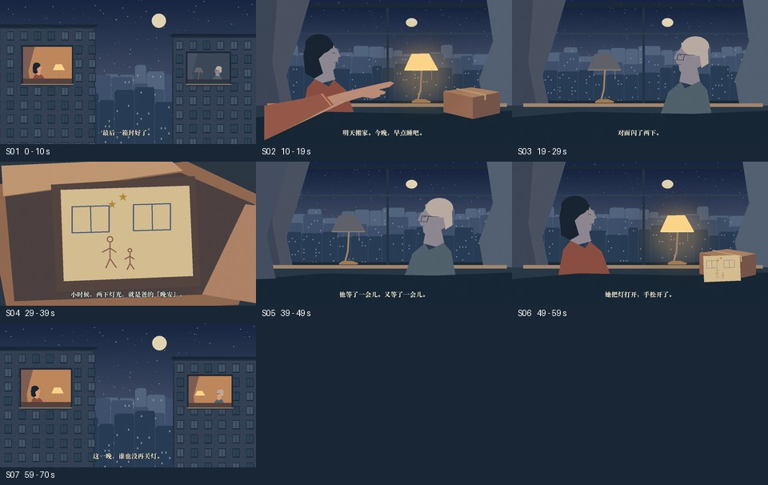

# 留灯

搬家前夜，女儿关掉最后一盏灯。街对面的窗闪了两下，她想起小时候父亲用灯光说晚安的暗号。

[剧本](sample/screenplay.md) · [定时分镜](sample/storyboard.md) · [本地动画 MP4](sample/local-animation.mp4) · [运行方法](../../docs/run.md)

示例覆盖 5 场、7 镜，时长 70 秒。夜蓝、锈红与蜜黄色是两间房的统一色彩，关灯、闪灯、回灯三个动作推动剧情。前后使用同样的两扇窗，最后一次回到街口时，两盏灯一起留在画面中。

`project.json` 是剧本、定时分镜和镜头参数的来源。`assets/` 中的原创剪纸画、可动图层和夜间音效用于可复现的本地动画。`sample/local-animation.mp4` 是此路径的输出，H.264 / AAC、1280 × 720、24 fps、1680 帧。Lumina 运行时从相同的内容母版制作其独立的生成版本。
